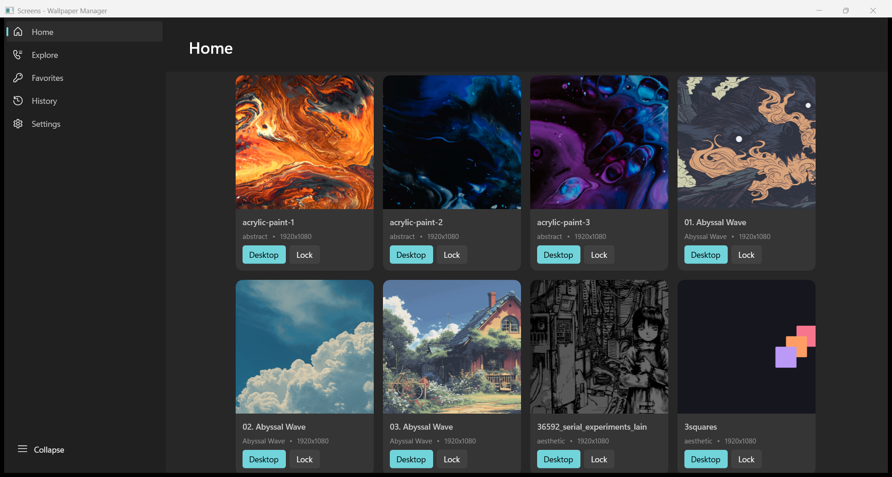
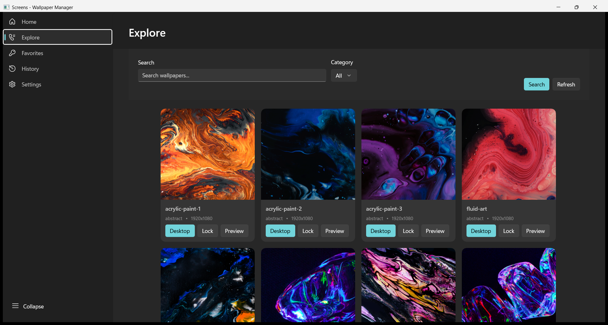

<div align="center">

# Screens

**A native Windows 11 wallpaper manager built with WinUI 3.**

[](./LICENSE)
[](https://learn.microsoft.com/windows/apps/winui/winui3/)
[](https://dotnet.microsoft.com/)
[](#quick-start)

[Features](#features) · [Screenshots](#screenshots) · [Quick start](#quick-start) · [Wallpapers](#wallpapers) · [Architecture](#architecture) · [Known limitations](#known-limitations)

</div>



---

## Screenshots

| | |
|---|---|
| **Home** — your local library, grouped into categories | **Explore** — search, category filter and preview |
|  |  |

## What this is

Screens is a local-first wallpaper manager for Windows. Point it at a `Wallpaper/` folder, and every
subfolder becomes a category. Browse the library, filter it, preview a wallpaper, then apply it to the
desktop or the lock screen — or run a GIF as a live wallpaper behind your icons.

There is no account, no API key and no cloud. Your wallpapers stay on your disk, and the app reads them
from the folder next to the executable. A small SQLite database is wired in for favorites and download history.

It is built with WinUI 3 and .NET 8 as an unpackaged x64 desktop application.

## Features

- **Local library with automatic categories** — scans `Wallpaper/`, treats each subfolder as a category.
- **Search, category filter and preview** — find a wallpaper quickly and inspect it before applying.
- **Apply to the desktop** — uses the Win32 `SystemParametersInfo` API with fit/fill/span styles.
- **Apply to the lock screen** — writes the lock-screen image through the registry.
- **Live wallpapers** — plays video and GIF wallpapers in a desktop-parented WPF `MediaElement`.
- **Favorites and download history** — backed by a local SQLite repository.
- **MVVM with dependency injection** — view models and services are wired through
  `Microsoft.Extensions.DependencyInjection`.
- **Fluent Windows 11 UI** — a `NavigationView` shell with custom Windows 11 styles, light and dark themes.

## Quick start

### Prerequisites

- Windows 10 version 1809 (build 17763) or newer — Windows 11 recommended
- [.NET 8 SDK](https://dotnet.microsoft.com/download/dotnet/8.0)
- Optional: Visual Studio 2022 with the **Windows App SDK / WinUI** workload

### Build and run

```bash
git clone https://github.com/ItsAakif/Screens.git
cd Screens
dotnet build Screens.WinUI.csproj -p:Platform=x64
```

Run the executable from the build output:

```text
bin\x64\Debug\net8.0-windows10.0.22621.0\Screens.WinUI.exe
```

Or open `Screens.WinUI.sln` in Visual Studio, select the **x64** platform and press **F5**.

The app expects the `Wallpaper/` folder next to the executable. The build copies it there automatically,
so the sample library is available on first launch.

## Wallpapers

The library is just a folder tree. Each immediate subfolder is a category; the files inside it are
wallpapers.

```text
Wallpaper/
├── abstract/
│   ├── acrylic-paint-1.jpg
│   └── acrylic-paint-2.jpg
├── Animated/
│   ├── 01. Animated.gif
│   └── 02. Animated.gif
├── Architecture/
│   ├── allec-gomes-bE7D3J-3t3g-unsplash.jpg
│   └── barmaan-0fPLISfPfeg-unsplash.jpg
└── Rosé Pine/
    ├── 01. Rosé Pine.jpg
    └── 02. Rosé Pine.jpg
```

- **Supported extensions:** `.jpg`, `.jpeg`, `.png`, `.gif`, `.bmp`, `.webp`.
- **Categories:** every subfolder of `Wallpaper/` becomes a category. Create your own folders and drop
  images in; no configuration is required.
- **Samples:** the repository ships with about 100 royalty-free sample wallpapers across 50+ categories.
  Add your own files alongside them or replace the folder entirely.
- Large images are fine; sample images in this repository are capped at 1920 px on the longest side to keep
  the checkout small. Animated GIFs are kept as-is.

## Architecture

| Component | Responsibility |
| --- | --- |
| `App.xaml.cs` | Builds the DI container and initializes services at startup |
| `MainWindow.xaml` / `.cs` | `NavigationView` shell; hosts pages in a `Frame` |
| `ViewModels/` | MVVM view models for Home, Explore, Favorites, History, Settings and Generate |
| `Views/Pages/` | The XAML pages for each section |
| `Services/` | Wallpaper application, live wallpaper, SQLite repository, image cache, logging, settings, navigation |
| `Providers/` | `LocalWallpaperProvider` reads the on-disk library; the Unsplash and Pexels providers exist but are not registered |

```
Screens.WinUI/
├── App.xaml / App.xaml.cs      application entry point and DI
├── MainWindow.xaml / .cs       NavigationView shell
├── ViewModels/                 MVVM view models
├── Views/
│   ├── Pages/                  Home, Explore, Favorites, History, Settings, Generate
│   └── WallpaperPreviewDialog.xaml
├── Services/                   wallpaper, live wallpaper, database, cache, logging, settings
├── Providers/                  local provider (+ unregistered Unsplash/Pexels clients)
├── Models/                     wallpaper and settings models
├── Styles/                     Windows 11 theme resources
└── Wallpaper/                  the local wallpaper library, copied to the output directory
```

## Known limitations

- **Explore loads the whole library at once.** The grid receives every wallpaper in the collection, which
  is slow with very large libraries (4,000+ images). It settles once loading finishes.
- **Local persistence is not reliable in the unpackaged build.** Services use
  `ApplicationData.Current`, which is not dependable without package identity; the Settings page can crash
  in that configuration.
- **Live wallpapers depend on the classic Explorer desktop.** They attach to `Progman`/`WorkerW`, so they
  may not appear on every shell or with every Windows configuration.
- **GIF playback can be static.** Animated GIFs are loaded through WPF imaging and may show a single frame instead of animating.
- **Lock-screen changes are policy-gated.** The image is written through a personalization policy key and silently does nothing when the policy is absent.
- **Unpackaged x64 desktop app.** Distribution is a plain executable build, not an MSIX package.

## License

[MIT](./LICENSE). Use it, fork it, change it.
